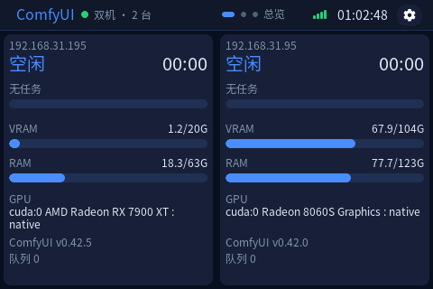
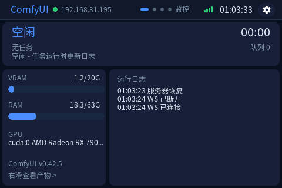
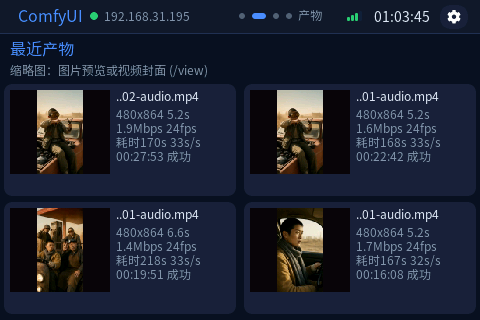
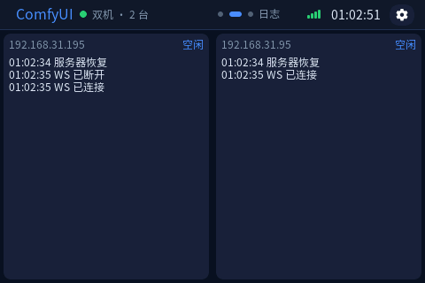
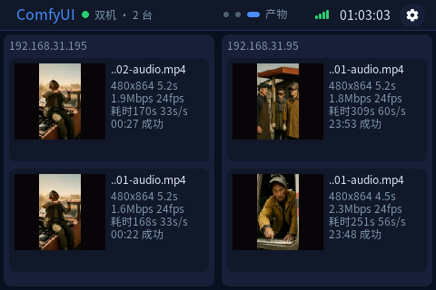
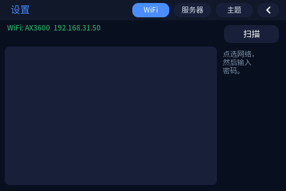
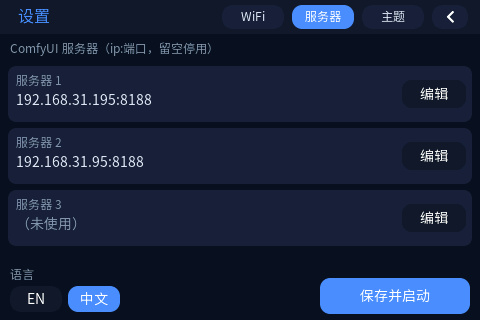
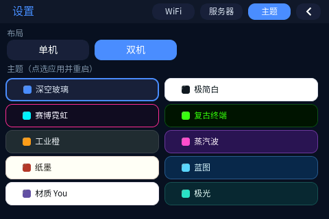
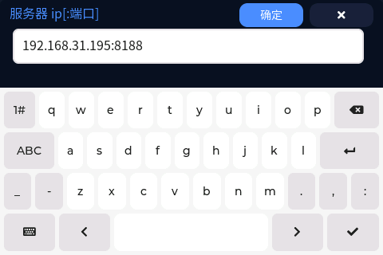

# ComfyUI LAN Monitor Panel

Waveshare **ESP32-S3-Touch-LCD-3.5**（ST7796S 320×480 SPI、FT6336U 触摸、TCA9554 扩展器）上的横屏 ComfyUI 局域网看板。设备端完成 WiFi 扫描/配网，实时读取 ComfyUI（默认 8188）的运行状态、采样进度、运行日志与产物信息。

> A 480×320 ComfyUI monitor for the Waveshare ESP32-S3-Touch-LCD-3.5. On-device WiFi setup, WebSocket progress, run log, output metadata/thumbnails, offline detection, 1–4 host auto layouts, 10 themes, English/中文.



## 功能

- **按服务器数量自动选布局**（设置里不再手选，保存服务器后立即生效）
  - 1 台：两页 —— `MONITOR`（状态/耗时/节点与步数/每步耗时/显存/内存/运行日志）+ `OUTPUTS`（最近 4 条产物）。
  - 2 台：三页 —— `总览`（2 列）/ `日志`（2 列）/ `产物`（每台 2 条）。
  - 3 台：三页 —— 每页 3 列（窄格，产物每台 1 条）。
  - 4 台：三页 —— 每页 2×2 网格（短格：状态/进度/显存/内存/队列，产物每台 1 条）。
  - 同一套单元格里按剩余高度逐行决定显示哪些字段，因此 4 种布局共用一份绘制代码；10 套配色对 4 种布局都适用。
- **10 套主题**，运行时生效（LVGL 调色板 + 控件重建）：Dark Glass、Minimal Light、Cyber Neon、Terminal、Industrial、Synthwave、Paper Ink、Blueprint、Material You、Aurora。
- **中英文切换**，内置 4 个字号的中文字体子集（12/14/16/20，来自 OFL 的 Source Han Sans SC），同时保留 Montserrat 作为图标字体。
- **设备端配网**：屏幕扫描 WiFi → 虚拟键盘输入密码；服务器列表支持最多 4 台（`ip[:port]`，留空自动压缩）。
- **状态栏**：服务器状态点（全在线绿 / 部分在线黄 / 全离线红）、`n/m 台在线`、页码组、WiFi 四格信号（RSSI 分级）、时钟、设置入口。
- **离线检测**：2 台以内 10 秒、3 台 15 秒、4 台 20 秒内没有任何 API 响应即判为 `OFFLINE / 离线`（刚上电先显示 `CONNECTING / 连接中`）；离线时耗时、节点、显存/内存、GPU 与版本一律置空，并提示检查电源 / IP:端口，恢复后自动回到空闲/生成中。
- **Ultra 硬件总览（可选）**：每台主机运行 `assistant/`（端口 A，默认 8189）后可开启 Ultra，总览页在原有状态/队列/进度/耗时之外，增加 **CPU / GPU / 内存 / 显存占用** 与 **整机/封装功耗**，并按 1/2/3/4 台重新排版（4 台走 2×2 紧凑瓦片）。助手自带赛博修仙风格 WebUI，可远程启停 ComfyUI（复刻本机启动方式，避免 SSH 拉起导致的 GPU 降频）。详见 [docs/HANDOFF.md](docs/HANDOFF.md)。
- **显卡显示**：厂牌标记 + 短型号（`NVIDIA eye + RTX 5070`、`AMD + RX 7900 XT`），不再是截断的 `cuda:0 AMD Radeon RX 7900 XT : native`；解析规则见 `gpuIdentify()`，两枚 16×16 标记由 `tools/gen_gpu_logos.py` 手绘位图生成（预览 `docs/gpu_logos_preview.png`，不引用第三方 logo 文件）。
- **采样进度**：兼容旧 `progress` 与新 `progress_state`；无采样事件时用节点进度兜底；运行日志滚动显示 `节点 / 步 x/y / 每步耗时 / 心跳 / 完成/错误`。
- **产物信息**：分辨率、视频时长、fps、码率（`HEAD /view` 的 Content-Length ÷ 时长）、生成耗时、每秒视频生成耗时（`s/s`）、产出时刻；缩略图支持图片 `/view?preview=jpeg`，视频使用 outputs 里的 `workflow` 首帧封面。
- **调试**：`http://<panel>:8080/shot.raw` 导出整屏帧缓冲（RGB565 LE）、`/stats`、`/debug/*`。

| 单机 MONITOR | 单机 OUTPUTS |
|---|---|
|  |  |

| 双机 DASH | 双机 LOGS | 双机 OUTPUTS |
|---|---|---|
|  |  |  |

| 设置 WiFi | 设置服务器/语言 | 设置主题 | 键盘 |
|---|---|---|---|
|  |  |  |  |

状态栏像素级对齐（3× 放大）：

主题对照（与固件内调色板一致）：

- 单机 MONITOR × 10：`docs/themes/single_themes_contact.png`
- 双机 DASH × 10：`docs/themes/dual_themes_contact.png`
- 双机三页：`docs/themes/dual_pages_contact.png`

## 目录

```
firmware/
  comfyui_panel/          主固件（.ino + 生成的 CJK 字体）
    fonts/OFL.txt          中文字体（Source Han Sans SC）许可证
  lv_conf.h               LVGL 配置（复制到 lvgl 库）
assistant/
  assistant.py            看板助手（端口 A：硬件采集 + 启停 ComfyUI + API）
  webui.html              赛博修仙风格 WebUI（「灵枢观星台」）
  start.sh / start.bat    本机启动脚本
diagnostics/
  bringup/                最小硬件自检（I2C/屏/触摸）
  screen_test/            显示诊断（色块、模式切换、跟手红点）
  orient_test/            横屏方向/触摸两点标定
  lcd_probe/              裸 SPI + TCA9554 寄存器探测
tools/
  build.sh                编译/烧录
  gen_lv_conf.py          从模板生成 LVGL 配置
  gen_cn_fonts.sh         从 Source Han Sans SC 生成字体子集
  gen_gpu_logos.py        生成 16x16 显卡厂牌标记 (gpu_logos.c)
  extract_cjk.py          提取固件用到的全部汉字
  prefill_staging.sh      国内网络预热 arduino-cli 工具链包
  raw_to_png.py           帧缓冲转 PNG
  parse_test.cpp          JSON 解析的电脑端测试
  theme_mockups.py        主题对照图生成
  patches/arduino_gfx_1.5.5_core3.patch
tests/                    上机测试（mock 数据源、探针、截图、记录）
docs/                     截图、主题对照图、接口文档（ASSISTANT_API.md）、开发接力手册（HANDOFF.md）
```

## 硬件

| 功能 | 引脚 |
|---|---|
| LCD SPI SCK / MOSI / MISO / DC | 5 / 1 / 2 / 3 |
| LCD CS | 无（硬件下拉，`CS=-1`） |
| LCD RST | TCA9554 EXIO1 |
| 背光 | GPIO6 |
| 触摸 FT6336U (0x38) | I2C SDA=8 / SCL=7 |
| 其它 I2C | AXP2101@0x34、TCA9554@0x20、ES8311@0x18、PCF85063@0x51、QMI8658@0x6B |

Flash 16MB / PSRAM 8MB（OPI）。横屏 `setRotation(1)`，触摸映射 `lx=rawY, ly=319-rawX`（已用 `orient_test` 标定）。

## 构建

依赖：

- `arduino-cli` + core `esp32:esp32@3.3.12`
- 库：`lvgl@8.4.0`、`SensorLib@0.5.1`、`TCA9554@0.1.3`、`ArduinoJson@7.4.3`、`WebSockets@2.7.2`、`JPEGDEC@1.8.5`
- **Arduino_GFX 1.5.5**（微雪 Demo 包内版本）。上游 1.6.9 的 ST7796 初始化在该面板上只亮背光，1.5.5 正常。1.5.5 配 core ≥3.3.6 需要打补丁：

```bash
# 1) 从 Waveshare ESP32-S3-Touch-LCD-3.5 Demo 包中取出
#    Arduino/libraries/GFX_Library_for_Arduino，放到 ~/Documents/Arduino/libraries/Arduino_GFX
# 2) 应用 SPI API 补丁
cd ~/Documents/Arduino/libraries/Arduino_GFX
patch -p0 < /path/to/repo/tools/patches/arduino_gfx_1.5.5_core3.patch
```

- **LVGL 配置**：`cp firmware/lv_conf.h ~/Documents/Arduino/libraries/lvgl/lv_conf.h`
  （已启用 `LV_TICK_CUSTOM=1`、FLEX、QRCODE、MONTSERRAT 12–36、刷新周期 20ms、64KB 堆等；模板默认 `#if 0`，必须为 `#if 1`）。

编译/烧录：

```bash
tools/build.sh                 # 只编译
tools/build.sh --upload        # 自动找 /dev/cu.usbmodem*
tools/build.sh --upload --port /dev/cu.usbmodemXXXX
```

### 中文字体

`firmware/comfyui_panel/cn_font_*.c` 是从 **Source Han Sans SC**（与 Noto Sans CJK SC 同源）生成的 4 个字号子集（SIL OFL 1.1，见 `firmware/comfyui_panel/fonts/OFL.txt`）。修改界面中文后重新生成：

```bash
tools/gen_cn_fonts.sh    # 需要 Node/npx；字体首次会自动下载
```

## 使用

1. 上电进入 `SETUP → WiFi`：`Scan` → 点选网络 → 键盘输入密码 → `OK`（最长 25 秒）。
2. `Servers`：填写 ComfyUI 的 `ip[:port]`（最多 4 台，留空自动压缩）→ `保存并启动`。
3. `Theme` 页只显示当前自动布局（N 台 → 列×行）并选择配色（重启生效）；`Servers` 页左下角切换 `EN/中文`。设置都保存在 NVS。
4. 左右滑动切换页面；⚙ 随时返回设置；长按 BOOT 3 秒清空配置。

## ComfyUI API 说明（踩坑记录）

- `/system_stats` 提供显存/内存/GPU 名/版本；**不提供 CPU/GPU 利用率、温度、磁盘**。
- **ROCm/CUDA 版本**没有独立字段，只能从 `system_stats` 的 `system.pytorch_version` 的构建后缀解析：`2.14.0+rocm10.1.0` → `ROCm 10.1.0`，`2.7.1+cu128` → `CUDA 12.8`（另支持 `+mps`、`+cpu`；`+git`/`+cu126a` 之类无法识别时留空）。1 台/2 台的宽格显示在版本行里（`ComfyUI v0.43.0 · ROCm 10.1.0`），1 台的详情页单独一行，3/4 台的窄格与短格放不下时省略。
- `/queue` 提供 running/pending；`/history` 只有文件名与状态时间戳，**没有缩略图字段**。
- WebSocket 的 `executing / progress / progress_state / execution_start/success/cached` **只发给提交该任务的 `client_id`**（ComfyUI `execution.py` 中 `send_sync(..., server.client_id)`）。本固件从 `/queue` 运行项的 `extra_data.client_id` 读取并**用同一 id 重连 WS**，因此被动监控也能拿到节点/步数。
- 缩略图没有官方接口：`/view?preview=jpeg;quality=N` 是服务端转码（仅图片），视频则使用 outputs 中的 `workflow` PNG 首帧封面；失败显示占位并退避重试。
- 码率用 `HEAD /view` 的 `Content-Length` ÷ 视频时长计算，不下载原文件。

## Ultra 硬件总览（看板助手）

ComfyUI 的 8188 不提供 CPU/GPU 利用率、功耗等数据，因此每台主机可另跑一个只依赖 Python 标准库的助手（端口 A，默认 8189），面板开启 Ultra 后从 `http://<host>:8189/api/panel` 拉取并排版。

- Windows 免装 Python：直接下载 [ComfyUIPanelAssistant.exe（v1.3.1 Release）](https://github.com/LAZTUDIO/Comfyui-ESP32-LCD/releases/download/v1.3.1/ComfyUIPanelAssistant.exe)，双击运行（源码方式见下）。
- 部署（每台主机 Linux / Windows 通用）：

  ```bash
  python3 assistant/assistant.py --port 8189      # Windows 双击 start.bat（桌面会话）
  curl http://127.0.0.1:8189/api/panel            # 自检
  ```

- 面板：`设置 → 服务器` 页打开 `Ultra`、端口 A 填 `8189`；总览页立即按主机数重排。
- 助手 WebUI：`http://<host>:8189/`，可查看完整硬件/日志并启停 ComfyUI（与本机手动启动一致）。
- 远程启停/状态接口（供调度站、Agent、自动化脚本调用，无需 SSH）：

  ```bash
  curl -X POST http://<host>:8189/api/comfy/start            # 启动（异步，轮询 /api/panel 的 comfy.up 判就绪）
  curl -X POST http://<host>:8189/api/comfy/stop             # 停止（队列有任务时被拒，须 {"force":true}）
  curl http://<host>:8189/api/panel                          # 轻量状态（硬件 + 队列，1~2s 轮询）
  curl http://<host>:8189/api/status                         # 全量状态（含 state 机、PID、版本）
  ```

  接口全量文档（9 个接口、状态机、force 语义、Linux/Windows 字段差异、告警阈值建议）：[docs/ASSISTANT_API.md](docs/ASSISTANT_API.md)。
- Linux 建议用 systemd 常驻；**Windows 必须在桌面会话运行**，SSH/服务会话启动 ComfyUI 会导致 GPU 性能下降（助手 `session_warning` 字段可检测此状态）。
- 字段契约、平台采集差异、部署与排障见 [docs/HANDOFF.md](docs/HANDOFF.md)。

## 调试接口

- `GET http://<panel>:8080/shot.raw` → 整屏 RGB565 LE（480×320×2），`tools/raw_to_png.py` 转 PNG。
- `GET /stats` → WiFi/服务器/WS/队列/堆/`ui_max_ms`。
- `GET /debug/show?s=dash|setup|servers|theme`、`/debug/page?i=N`、`/debug/scan`、`/debug/edit?i=N`、`/debug/thumb`、`/debug/theme?i=N`、`/debug/lang?i=1`、`/debug/host?i=0&h=ip[:port]`、`/debug/addhost?h=ip[:port]`、`/debug/delhost?i=N`（调试用；theme/lang 会重启，host 系列会按新机数重建布局）。

## 已知限制

- 中文字体为 UI 文本子集；WiFi 列表里的中文 SSID、手动输入的非常用汉字可能显示方框。
- 缩略图依赖非官方 `/view` 接口；mp4 本身无缩略图，需工作流提供 `workflow` 封面。
- 网格布局会轮询全部主机：主机越多轮询越慢（2 台 3s/2s、3 台 4s/3s、4 台 5s/3.5s），离线判定阈值也相应放宽；产物页才拉缩略图/码率。
- 主题/语言切换会重启设备（约 3 秒）；服务器数量变化不需要重启，保存后立即重建布局。
- MIT License（见 `LICENSE`）；中文字体为 Source Han Sans SC 子集，遵循 SIL OFL 1.1。
